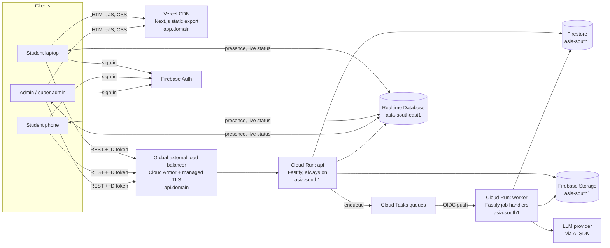
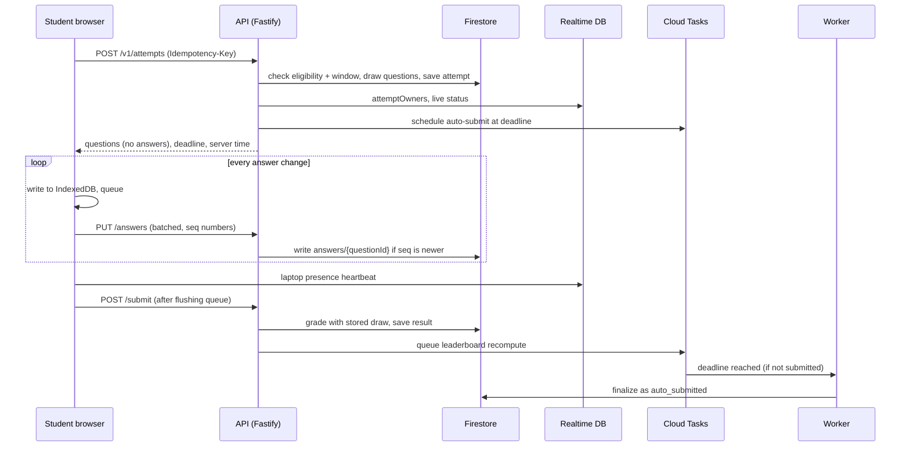

# SYSTEM\_DESIGN — MITAOE Prep Platform

Oct 17, 2026 · @keith

## 1. Overview

MITAOE Prep is being rebuilt from scratch as a multi-tenant SaaS for proctored placement exams. Super admins onboard colleges (organizations), college admins run test series, and students take server-graded, proctored exams. The v1 sizing target is several organizations, up to about 2,000 students per organization, and about 500 students taking the same exam at once.

### 1.1 Goals

- **Multi-tenant SaaS.** Every organization's data is isolated. Super admins control which features and limits each organization gets.
- **Exam integrity.** Timing, grading and strike counting are decided by the server. Proctoring runs on the student's device, with an optional phone as a second camera.
- **Fast authoring.** Admins import questions from PDF, Excel/CSV, TXT, MD or JSON. An LLM converts them to structured questions, and nothing goes live until an admin reviews and approves it.
- **A distinctive, accessible UI** that feels hand-designed, for super admins, admins and students alike.
- **Serverful backend.** An always-warm API in Mumbai gives predictable latency with no cold starts.

### 1.2 Non-goals for v1

- Recording, streaming or uploading camera video or snapshots. Only proctoring events leave the device.
- Coding questions that execute code. v1 covers objective questions only.
- Native mobile apps. The phone-camera page is mobile web.
- Automated billing and payments. Plans are assigned manually by super admins.
- Finer admin roles inside an organization. There is one admin role per organization.

### 1.3 How to read this document

Every requirement has an ID (for example `EX-07`) so commits, pull requests and tests can reference it. Items marked **Proposed** were suggested during design but not yet signed off; build them only after confirmation. Everything else is agreed scope.

| ID prefix | Area |
| --- | --- |
| `ORG` | Organizations and super-admin console |
| `FF` | Plans, feature flags and limits |
| `AUTH` | Authentication and onboarding |
| `WL` | Whitelists |
| `STU` | Student directory and profiles |
| `SER` | Test series |
| `TST` | Tests |
| `Q` | Questions, pools and marking |
| `IMP` | AI-assisted import |
| `EX` | Exam engine |
| `PR` | Proctoring |
| `RES` | Results and release |
| `LB` | Leaderboards |
| `OPS` | Live exam operations |
| `EXP` | Exports and analytics reports |
| `AUD` | Audit logs |

### 1.4 Glossary

| Term | Meaning |
| --- | --- |
| Super admin | Platform owner (us). Manages organizations, admins, plans and feature flags, and can do everything an admin can do in any organization. |
| Organization | A tenant, usually a college, for example MIT. All data belongs to exactly one organization. |
| Admin | Staff member of one organization. Manages its whitelist, students, series, tests and results. |
| Student | A whitelisted candidate who signs in, completes a profile and takes tests. |
| Whitelist | The list of emails (and optionally PRNs) allowed to sign in to an organization. |
| Test series | A container of tests, usually one per day, sharing default settings and eligibility. |
| Test | One timed exam inside a series. It can override any series setting. |
| Section | An optional group of questions inside a test, for example Quant or Verbal. |
| Pool | A larger set of questions from which each student receives a random draw. |
| Attempt | One student's sitting of one test, including drawn questions, answers, strikes and result. |
| Strike | A recorded proctoring violation. Reaching the maximum terminates the attempt. |
| Fixed slot | Timing mode where everyone takes the test in the same slot and finishes together. |
| Flexible window | Timing mode where students start any time within a window and each gets the full duration. |

### 1.5 Working with Claude Code

- The previous codebase lives in `/legacy`, read-only. It is a reference for reimplementation (MediaPipe face detection, lockdown handlers, OMR palette logic, Dockerfile), never a source to copy wholesale.
- `CLAUDE.md` at the repo root points to this file and to the known legacy flaws listed in section 15.
- Build in the phases in section 15. Each phase ends with typecheck, tests and a short demo against its requirement IDs.

## 2. Roles, tenancy and feature entitlements

There are three roles: super admin, admin and student. Admins and students belong to exactly one organization, and super admins decide which features each organization can use. Super admins also hold full admin access in every organization: anything an admin can do, a super admin can do too.

### 2.1 Permission matrix

| Capability | Super admin | Admin | Student |
| --- | --- | --- | --- |
| Create, suspend and archive organizations | Yes | No | No |
| Add and remove admins of an organization | Yes | No | No |
| Set plan, feature flags and limits per organization | Yes | No | No |
| View any organization's data and audit log | Yes | Own org only | No |
| Manage whitelist and student records | Yes (any org) | Own org | No |
| Create series, tests and questions | Yes (any org) | Own org | No |
| Run live exam operations (extra time, reset, terminate) | Yes (any org) | Own org | No |
| Export results and generate analytics reports | Yes (any org) | Own org, if the feature is enabled | No |
| Complete own profile, take eligible tests | No | No | Yes |
| View own results, history and leaderboards | No | No | Yes, as released by the admin |

All admins of an organization have the same permissions. Finer roles are out of scope for v1.

### 2.1.1 Super admins as admins

A super admin has every admin capability in every organization, with no exceptions.

- **ORG-09** An organization switcher at the top of the sidebar lets a super admin enter any organization's admin workspace. There they see exactly the screens an admin sees: whitelist, students, departments, series, tests and days, questions and imports, live dashboard, results, exports, reports and audit log.
- **ORG-10** In that workspace a super admin can create, edit, publish, delete and run everything an admin can: series, tests, day numbers and schedules, settings and overrides, eligibility, questions and approvals, result release, leaderboards, extra time, resets and terminations.
- **ORG-11** Every admin API route accepts a super-admin token together with an `X-Org-Id` header (API-04). Route guards check "admin of this organization, or super admin", never a single role.
- **ORG-12** A persistent banner shows which organization the super admin is working in. Every action is audit-logged in that organization with the super admin as the actor (ORG-04).
- **ORG-13** Feature flags and limits apply in the workspace as they do for the organization's admins, and usage counts against that organization. A super admin who needs a disabled feature enables it for the organization first, which is itself audit-logged.
- **ORG-14** The automated test suite runs every admin endpoint with both an admin token and a super-admin token.

### 2.2 Tenant isolation

- **ORG-01** Every stored record carries its `orgId`, and organization data lives under `organizations/{orgId}/…` (section 10).
- **ORG-02** The user's role and `orgId` are stored as Firebase Auth custom claims. The API reads them from the verified token on every request.
- **ORG-03** Every data-access function takes `orgId` as a required argument. No query can run without an organization scope, except super-admin list views across organizations.
- **ORG-04** When a super admin acts inside an organization, the request carries an explicit organization context and the action is written to that organization's audit log.
- **ORG-05** Automated tests must prove that an admin of organization A gets `404` (not `403`) for every resource of organization B, so the existence of other tenants' data is not revealed.

### 2.3 Organization lifecycle

- **ORG-06** A super admin creates an organization with a name, a URL slug, a timezone (default `Asia/Kolkata`), a logo and a department list (section 4).
- **ORG-07** Status is `active`, `suspended` or `archived`. A suspended organization's admins and students cannot sign in, and its data is kept. An archived organization is read-only for super admins.
- **ORG-08** A super admin adds admins by email. The admin signs in with Google, and the account is matched by email and gets the `admin` claim for that organization.

### 2.4 Feature flags and limits

Every organization gets every feature by default, except premium features that are off until a super admin enables them. Flags can also carry numeric limits.

- **FF-01** A feature's effective value is resolved in this order: the organization's override, then its plan, then the system default.
- **FF-02** The API enforces every flag and limit. Hiding a button is not enough: a disabled feature's endpoints return `403 FEATURE_DISABLED`.
- **FF-03** In the UI, a disabled feature appears locked with a one-line explanation ("Not included in your organization's plan"), never as a broken or missing control.
- **FF-04** Usage limits are counted per organization per calendar month with atomic counters, and checked before a job starts.
- **FF-05** Changes to flags and limits are audit-logged with before and after values.

| Flag | Controls | Default |
| --- | --- | --- |
| `ai_question_import` | LLM import from PDF, Excel, TXT, MD | On, with a monthly import limit |
| `question_pools` | Random draws from a larger pool | On |
| `sections` | Sectioned tests | On |
| `negative_marking` | Negative marks | On |
| `per_question_timer` | Time limit per question | On |
| `second_camera` | Phone as second proctoring camera | On |
| `public_leaderboards` | Series and test leaderboards | On |
| `extra_time_grants` | Per-student extra time | On |
| `results_export` | CSV and Excel result exports | On |
| `analytics_reports` | PDF analytics report with AI-written summary | **Off**, super admin enables |

| Limit | Unit | Default |
| --- | --- | --- |
| `max_students` | Whitelisted students | 2,000 |
| `max_admins` | Admins | 10 |
| `ai_imports_per_month` | Import jobs | 50 |
| `ai_reports_per_month` | Analytics reports | 20 |
| `storage_gb` | Uploaded files and reports | 10 |

Default limit values are placeholders for the super admin to tune.

- **FF-06 (Proposed)** Plans such as Basic and Pro act as named presets of flags and limits, so pricing stays simple while per-organization overrides handle exceptions.

## 3. User stories

Each story has acceptance criteria that double as test cases. Stories map to the detailed requirements in sections 4 to 8.

### 3.1 Super admin

| ID | Story | Acceptance criteria |
| --- | --- | --- |
| US-SA-01 | As a super admin, I create an organization so a college can start using the platform. | Name, slug, timezone, logo and departments saved. Slug is unique. Organization appears in the list as active. |
| US-SA-02 | I add and remove admins for an organization. | Admin added by email gets access on next sign-in. Removed admin loses access within one token refresh (at most 1 hour, forced immediately by revoking tokens). |
| US-SA-03 | I turn features on or off and set limits per organization. | Change applies to the next API request. Disabled features show as locked in that organization's UI. Change is audit-logged. |
| US-SA-04 | I see usage per organization. | Students, admins, tests run, AI imports and reports used this month, storage used, each against its limit. |
| US-SA-05 | I suspend or archive an organization. | Suspended: nobody in it can sign in, data kept. Archived: read-only. Both reversible and audit-logged. |
| US-SA-06 | I read audit logs across all organizations. | Filter by organization, actor, action and date range. |
| US-SA-07 | I do everything an admin can do, in any organization: series, tests, days, questions, results and live exams. | The organization switcher opens that organization's full admin workspace. Every action is logged with me as the actor. |

### 3.2 Admin

| ID | Story | Acceptance criteria |
| --- | --- | --- |
| US-AD-01 | I upload a whitelist so only our students can sign in. | CSV, XLSX or pasted list accepted. Duplicates and invalid emails reported before saving. Department not required. |
| US-AD-02 | I view, edit, delete and manually add student records. | Changes save instantly and are audit-logged. Deleting a student with attempts asks for confirmation and keeps their results. |
| US-AD-03 | I maintain our department list. | Students pick their department from this list, so eligibility filters match exactly. |
| US-AD-04 | I create a test series with default settings and eligibility. | All series settings in section 5 available. Eligibility filters show a live count of matching students. |
| US-AD-05 | I add tests to a series and override settings per test. | Each setting shows whether it is inherited or overridden, and can be reset to inherited. |
| US-AD-06 | I import questions from a file and review them before use. | Each question shows as valid or flagged. Nothing is added to a test until I approve it. |
| US-AD-07 | I configure sections, pools, difficulty mix, marking and per-question timers. | Configuration is validated: for example, a pool cannot draw more questions than it holds. |
| US-AD-08 | I preview a test exactly as a student will see it. | Preview uses the real exam screen, without saving an attempt or triggering proctoring. |
| US-AD-09 | I publish a test only after approving it. | Unapproved tests cannot be scheduled or shown to students. |
| US-AD-10 | I control when and how much of the results students see. | Release timing, detail level, score history and leaderboards configurable per series and per test. |
| US-AD-11 | I watch a live exam in real time. | Status of every student updates within 5 seconds, with filters for strikes, phone disconnected and not started. |
| US-AD-12 | I give a student extra time. | Their deadline moves, their timer updates within 5 seconds, and the grant is audit-logged with a reason. |
| US-AD-13 | I reset a student's attempt after a genuine failure. | Requires a reason, keeps the old attempt archived, and is audit-logged. |
| US-AD-14 | I export results for a test or a whole series. | CSV and XLSX with scores, sections, strikes, timings and profile fields. |
| US-AD-15 | I generate an analytics report, if our plan includes it. | PDF with computed statistics and an AI-written summary. Locked if the feature is off. |
| US-AD-16 | I read my organization's audit log. | Every admin action is listed with actor, time and change. |
| US-AD-17 (Proposed) | I correct a wrong answer key and regrade. | All affected attempts are rescored, leaderboards recomputed, and the change logged. |

### 3.3 Student

| ID | Story | Acceptance criteria |
| --- | --- | --- |
| US-ST-01 | I sign in with Google. | Whitelisted email gets in. Others see a clear message naming who to contact, with no technical error. |
| US-ST-02 | I complete my profile the first time I sign in. | Name, PRN, department, graduation year required before anything else. Editable later unless the admin locks it. |
| US-ST-03 | I see my live, upcoming and completed tests. | Each shows its window, duration and a countdown. Tests I am not eligible for are not shown. |
| US-ST-04 | I check my device and pair my phone before the exam. | Preflight checks screen size, fullscreen, camera, face detection and connection. Phone pairs by scanning a QR code. |
| US-ST-05 | I take the exam without losing answers if the network drops. | Every answer is saved locally at once and synced when the connection returns. An indicator shows sync state. |
| US-ST-06 | I know when I get a strike and how many remain. | A warning appears immediately with the reason and the remaining count. |
| US-ST-07 | I see my result as the admin released it. | Score only, score with sections, or a full review with correct answers and explanations. |
| US-ST-08 | I see my history by series and day. | Lists every attempt, with scores only where the admin allows. |
| US-ST-09 | I see the leaderboard, if enabled. | My own rank is highlighted. |
| US-ST-10 | I adjust text size, contrast, theme and motion. | Settings persist on my account and apply in the exam too. |

## 4. Sign-in, whitelists and student records

Students get in only if their email is on their organization's whitelist. Department and other details are collected from the student at first sign-in, not when the whitelist is created.

### 4.1 Authentication

- **AUTH-01** Everyone signs in with Google through Firebase Authentication. Desktop uses a popup, with a redirect fallback when popups are blocked.
- **AUTH-02** After sign-in, the client calls `POST /v1/session/bootstrap`. The API resolves the account in this order: super-admin list, admin record by email, then whitelist entry by email. It then sets custom claims `{ role, orgId, studentId? }` and tells the client to refresh its token.
- **AUTH-03** An email with no match is rejected with a plain message: "This Google account isn't on any organization's list. Ask your placement cell to add it."
- **AUTH-04** If an email is whitelisted in more than one organization, the student chooses one at sign-in. The claims hold one active `orgId`, and switching organizations repeats the bootstrap.
- **AUTH-05** Every API request carries `Authorization: Bearer <Firebase ID token>`. The API verifies it with `firebase-admin`. Admin and super-admin mutations also check token revocation.
- **AUTH-06** Removing an admin, or disabling or removing a student, revokes their refresh tokens. The API also checks account status, cached in memory for 60 seconds, so access ends promptly.
- **AUTH-07 (Proposed)** An optional allowed-domain rule per organization (for example `@mitaoe.ac.in`) as a second guard on top of the whitelist.

### 4.2 Profile completion

- **STU-01** On first sign-in, a student must complete the profile before seeing anything else. Required fields: full name, PRN, department (chosen from the organization's list) and graduation year.
- **STU-02** PRN is unique within an organization. If the whitelist entry already has a PRN, the field is prefilled and locked.
- **STU-03** Admins can lock profile editing after completion, per organization. When locked, students see their profile read-only, with a note to contact the admin for changes.
- **STU-04 (Proposed)** Optional phone number field, for exam-day contact.

### 4.3 Departments

- **STU-05** Each organization keeps its own department list (for example Computer, IT, ENTC, Mechanical), managed by admins.
- **STU-06** Students store a `departmentId`, not free text, so eligibility filters match exactly and renaming a department updates everywhere at once.
- **STU-07** A department in use cannot be deleted, only merged into another one or archived.

### 4.4 Whitelist

- **WL-01** A whitelist entry holds an email (required, stored lowercase and trimmed), an optional PRN and an optional note. It never asks for department.
- **WL-02** Admins add entries by uploading CSV or XLSX, pasting a list, or adding one at a time. Uploads go through a column-mapping step with a preview of the first rows.
- **WL-03** Before saving, the admin sees a validation report: invalid emails, duplicates within the file, entries already present, and whether the total exceeds the organization's `max_students` limit.
- **WL-04** Entry status is `invited` (not yet signed in), `registered` (profile complete) or `disabled`.
- **WL-05** Bulk actions: disable, enable, remove and export. Removing a registered student's entry disables the student but keeps their attempts and results.

### 4.5 Student directory

- **STU-08** A table of all students with search (name, email, PRN), filters (department, graduation year, status), sortable columns, a column picker and a density toggle.
- **STU-09** Admins can edit any profile field, disable or delete a student, and add a student manually. A manual add creates the whitelist entry and the profile together. The student's status stays `invited` until they first sign in.
- **STU-10** A student detail page shows the profile, every attempt with its score and strikes, and the audit trail of changes made to this student.
- **STU-11** Every create, edit, disable and delete is audit-logged with before and after values.

## 5. Test series and tests

A series holds default settings and eligibility. Each test inside it, usually one per day, inherits those defaults and can override any of them. The value used at exam time is resolved in this order: the test override, then the series default, then the system default.

### 5.1 Series

- **SER-01** A series has a title, an optional description, an overall start and end date, default settings (5.4) and eligibility rules (5.3).
- **SER-02** Series status is `draft`, `active` or `archived`. Students see only active series they are eligible for.
- **SER-03** The series page lists its tests in scheduled order, as a day-by-day timeline with each test's status.

### 5.2 Tests

- **TST-01** A test has a title, an optional target company (for example TCS), an optional day number and a scheduled date.
- **TST-02** Day number is optional. When the admin leaves it empty, it is suggested from the test's position in schedule order ("Day 3"). Admins can rename it or hide it.
- **TST-03** Any series setting can be overridden per test. Each setting shows an **Inherited** or **Overridden** state, with a one-click reset to inherited.
- **TST-04** The test lifecycle is `draft`, then `in_review`, then `approved`, then `scheduled`, then `live`, then `closed`. A test can only be scheduled after its questions and preview are approved (section 6.7).
- **TST-05** When a test is published, its resolved settings are saved as a snapshot on the test record, so the exam reads one record instead of resolving three layers on every request.
- **TST-06** Once any attempt has started, duration, timing mode, maximum strikes, question set and marking are locked. Window end can still be extended, and release, leaderboard and visibility settings can still change.

### 5.3 Eligibility

- **SER-04** A student can take a test only if they are on the organization's whitelist with status `registered`, and they match the series eligibility rules.
- **SER-05** Rules combine: departments (any of the selected), graduation years (any of the selected), an explicit include list and an explicit exclude list. An empty rule means "no restriction".
- **SER-06** A test can narrow the series eligibility but never widen it.
- **SER-07** While editing rules, the admin sees a live count of matching students and can open the matching list.
- **SER-08** Eligibility is checked again by the server when an attempt starts, not only when the dashboard lists tests.

### 5.4 Settings

| Setting | Values | System default |
| --- | --- | --- |
| Timing mode | Fixed slot, or flexible window | Fixed slot |
| Window | Start and end date-time. On a series, a default daily time range applied to each test's scheduled date. | None, required |
| Duration | Minutes. In fixed slot mode it equals the slot length. | 60 |
| Late entry cutoff (fixed slot) | Minutes after slot start after which nobody can start | 15 |
| Window end policy (flexible) | Last start time leaves full duration, or hard close at window end | Last start time leaves full duration |
| Maximum strikes | 1 to 10 | 3 |
| Developer tools policy | Block and strike, block only, or allow (practice tests) | Block and strike |
| Fullscreen required | On or off | On |
| Laptop camera required | On or off | On |
| Second camera (phone) | On or off | Off |
| Shuffle questions | On or off | On |
| Shuffle options | On or off | On |
| Result release | Immediately on submit, after the window closes, manually, or never | After the window closes |
| Result detail | Score only; score with section breakdown; full review with correct answers and explanations | Score with section breakdown |
| Show past scores to students | On or off | On |
| Test leaderboard | On or off, with visibility after the window closes | Off |
| Series leaderboard | On or off. Cumulative across the series' tests. | Off |

- **SER-09** In flexible-window mode, releasing a full review before the window closes would leak answers to students who haven't started. The settings form blocks that combination and explains why.
- **SER-10** Explanations appear in a full review only for questions that have one (section 6).
- **SER-11 (Proposed)** Leaderboard identity: show full name, PRN, or name with department, per series.

### 5.5 Timing rules

The server computes each attempt's deadline once, when the attempt starts, and stores it. Extra time is added on top (section 8.4).

```text
Fixed slot
  can start:  slotStart <= now <= slotStart + lateEntryCutoff
  deadline:   slotEnd + extraTime          (latecomers get only the remaining time)

Flexible window, "last start leaves full duration"
  can start:  windowStart <= now <= windowEnd - duration
  deadline:   startedAt + duration + extraTime

Flexible window, "hard close"
  can start:  windowStart <= now <  windowEnd
  deadline:   min(startedAt + duration, windowEnd) + extraTime
```

- **TST-07** All times are stored in UTC and shown in the organization's timezone, with the timezone named next to any time a student acts on.
- **TST-08** Section timers, where configured, run inside the attempt deadline and can never extend it.

## 6. Questions, AI import and marking

Admins add questions by hand or import them from files through an LLM, and no question reaches students until an admin has reviewed and approved it. Sections, pools, difficulty mixes, negative marking and per-question timers are all optional.

### 6.1 Question model

| Field | Rules |
| --- | --- |
| Type | v1: single correct answer. Multiple correct and numeric answers are Proposed for later. |
| Prompt | Markdown with LaTeX math (KaTeX), code blocks with syntax highlighting, and images |
| Options | 2 to 6, each with text and an optional image |
| Correct answer | Required before approval. Never invented by the LLM. |
| Explanation | Optional Markdown. Shown in full reviews only when present. |
| Marks and negative marks | Optional. Inherited from section, then test (6.5). |
| Difficulty | Optional: easy, medium or hard |
| Section | Optional |
| Topic tags | Optional, for analytics |
| Time limit | Optional, in seconds (6.6) |
| Source | Manual, JSON, or AI import with job ID and source page |
| Status | Draft, flagged or approved |

- **Q-01** Admins can create and edit questions in an editor with a live student-view preview, and reorder them by drag and drop or keyboard.
- **Q-02 (Proposed)** An organization-wide question bank so questions can be reused across tests.

### 6.2 Import pipeline

Imports run as background jobs in the worker service, so an admin can upload, leave and come back to a review screen.

1. Admin uploads a file to Firebase Storage through a signed upload URL.
2. The API creates an import job and queues it.
3. The worker extracts content. JSON is parsed directly. Excel or CSV matching the template is parsed directly. PDF, TXT, MD and non-template sheets go to the LLM.
4. The LLM returns structured output, validated against the shared Zod question schema.
5. The worker runs checks (6.3) and saves the result as an import draft.
6. The admin reviews, fixes, approves or discards each question (6.4). Approved questions are added to the test.

- **IMP-01** Accepted formats: JSON, PDF, XLSX, CSV, TXT and MD. DOCX is Proposed for later.
- **IMP-02** Limits: 25 MB and 100 pages per PDF, 5,000 rows per sheet. Larger files are rejected with a message stating the limit.
- **IMP-03** PDFs are sent to a multimodal model as pages, so diagrams and tables are understood. Figures belonging to a question are cropped, stored and attached as question images.
- **IMP-04** The job shows live progress: pages processed and questions found. Jobs survive the admin closing the tab.
- **IMP-05** LLM instructions: keep the original wording; never invent a correct answer or an explanation; include an explanation only when the source has one; detect section headings; suggest a difficulty, marked as a suggestion.
- **IMP-06** File content is treated as data, never as instructions to the model.
- **IMP-07** The LLM provider is behind the AI SDK so it can be switched (Gemini on Vertex AI, OpenAI or Bedrock) by configuration. Each job logs provider, model, tokens and estimated cost.
- **IMP-08** Each AI import counts against the organization's `ai_imports_per_month` limit. JSON and template imports do not.

### 6.3 Validation and flags

- **IMP-09** Every imported question is checked for: a missing correct answer, fewer than 2 options, more than one correct option on a single-answer question, an empty prompt, a likely duplicate (within the import or already in the test), and a figure the text refers to but that is missing.
- **IMP-10** Each flagged question lists its reasons in plain words, for example "No correct answer found in the source." Flagged questions cannot be approved until fixed.

### 6.4 Review screen

- **IMP-11** Source page and parsed question side by side, with the question highlighted on the page where possible.
- **IMP-12** Per question: approve, edit inline or discard. In bulk: approve all valid questions. Flagged questions are grouped at the top.
- **IMP-13** Keyboard-driven review: next and previous question, approve, edit and discard each have a shortcut.

### 6.5 Sections, pools and marking

- **Q-03** Sections are optional. A section has a name, order, instructions, and optionally its own duration, draw count and forward-only navigation.
- **Q-04** A pool is the set of approved questions in a test or section. If a draw count is set, each student receives that many, for example 20 of 100.
- **Q-05** An optional difficulty mix per section, for example 2 easy, 2 medium and 1 hard, keeps different students' draws comparable. Saving is blocked if the pool cannot satisfy the mix.
- **Q-06** The draw is made once when the attempt starts, seeded by the attempt ID, and stored on the attempt with the option order. Refreshing never reshuffles, and grading always uses the stored draw.
- **Q-07** Marks resolve in this order: question, then section, then test. Negative marking is optional at each level.
- **Q-08** Marking scheme presets: +1 and 0; +1 and −0.25; +4 and −1; or custom. A preset only fills in values that can still be edited.
- **Q-09** Optional passing marks per test. Unanswered questions score 0. An option to floor a total at zero is available, off by default.

### 6.6 Per-question timers

- **Q-10** Optional. A time limit applies to every question in the test, or is set per question.
- **Q-11** When a question's time ends, its current answer is saved, the question locks, and the exam moves to the next one. With timers on, navigation is forward-only, and locked questions show as locked in the palette.
- **Q-12** The server enforces timers. It records when each question is first served and rejects answers after its limit plus a 2-second grace.

### 6.7 Preview and approval

- **Q-13** Preview runs the real exam screen in preview mode: no attempt is saved, proctoring is off, and a toggle reveals correct answers.
- **Q-14** Approval runs a checklist: every question valid, every draw satisfiable, total marks computed, settings resolved. The test can be scheduled only after approval.
- **Q-15** Editing an approved test before any attempt starts sends it back to `in_review`. After an attempt starts, the question set is locked (TST-06).

## 7. Exam engine and proctoring

The server owns the attempt: it draws the questions, fixes the deadline, counts strikes and grades. The browser saves every answer locally first, so a dropped connection never loses work.

### 7.1 Student journey

1. **Test page.** Window, duration, sections, marking and strike rules, with a countdown to the start.
2. **Preflight.** Device checks (EX-01).
3. **Rules and pairing.** Rules agreement, plus the phone QR code when a second camera is required.
4. **Exam.** Fullscreen, proctored, autosaving.
5. **Submitted.** Confirmation, and when results will be released.
6. **Result.** Shown according to the release settings.

### 7.2 Preflight and start

- **EX-01** Preflight checks, each with pass or fail and a one-line fix: screen width of at least 1024 px; fullscreen available; camera permission and face detection loaded, when required; API reachable, with round-trip time and clock offset measured; supported browser (current Chrome, Edge, Firefox, or Safari 17+).
- **EX-02** The rules screen shows duration, deadline, maximum strikes, marking, sections and a short privacy note: camera video never leaves the device. **Start test** is enabled only when every required check passes and the student ticks the agreement.
- **EX-03** Starting calls `POST /v1/attempts`. The server checks eligibility, the start window and any existing attempt. It then draws questions, computes the deadline, saves the attempt, schedules the auto-submit task, and returns the exam payload: questions without answers, option order, section config, server time and deadline.
- **EX-04** Starting is idempotent. Calling it again returns the same attempt, so a double click or a retry is harmless.
- **EX-05** Reopening the test after a crash or closed tab resumes the same attempt with saved answers. The deadline does not move.

### 7.3 Timer and navigation

- **EX-06** The timer shows `deadline − (device time + clock offset)`. The offset is measured at start and refreshed every 60 seconds from a server-time response header. Warnings appear at 10, 5 and 1 minutes remaining, visually and through a screen-reader announcement.
- **EX-07** The question palette shows each question's state with both colour and shape: not visited, visited without an answer, answered, marked for review, answered and marked, and locked (per-question timer).
- **EX-08** Students can mark for review, clear an answer, and jump between questions and between sections (unless a section is timed or forward-only).
- **EX-09** Keyboard shortcuts: `1` to `6` or `A` to `F` choose an option, `N` next, `P` previous, `M` mark for review, `?` shows all shortcuts. Shortcuts never conflict with lockdown keys.

### 7.4 Autosave that survives a dropped connection

- **EX-10** Every answer change is written to IndexedDB at once, then added to a sync queue. Each answer carries a per-question sequence number and an offset-corrected timestamp.
- **EX-11** The queue sends batches to `PUT /v1/attempts/{id}/answers`. The server keeps an answer only if its sequence number is higher than the stored one, so retries and out-of-order delivery are safe.
- **EX-12** Retries back off exponentially (1, 2, 4, 8, then every 15 seconds). A sync indicator shows **Saved**, **Saving**, or **Offline, 3 answers waiting**.
- **EX-13** Answers made offline are accepted if their timestamp is before the deadline and they arrive within 2 minutes after it. These are marked `late_sync` in the attempt log.
- **EX-14** Each answer is stored as its own record (section 10), so frequent saves never compete for one database record.

### 7.5 Submission

- **EX-15** **Submit test** opens a summary of answered, unanswered and marked questions per section. Confirming first flushes the sync queue, then submits. If offline, submission keeps retrying and says so.
- **EX-16** At the deadline, the client submits automatically. Independently, a Cloud Tasks job finalizes the attempt at its deadline, even if the browser is closed. The job is idempotent, and if the deadline was extended it reschedules itself.
- **EX-17** Grading runs on the server using the stored draw and the answer key. The result is saved on the attempt, and leaderboard recomputation is queued.

### 7.6 Laptop camera

- **PR-01** Face detection uses MediaPipe FaceDetector (BlazeFace short range), with model and WASM files self-hosted. It runs every 500 ms on the device.
- **PR-02** Violations: no face for longer than a grace period (default 5 seconds), or more than one face for longer than 2 seconds. Only the event is recorded, never an image.
- **PR-03** A small self-view preview helps students position themselves. They can collapse it, but cannot turn the camera off.

### 7.7 Browser lockdown

- **PR-04** Leaving fullscreen records a strike and shows a blocking overlay with one action: **Return to fullscreen**.
- **PR-05** Switching tabs, minimizing or the window losing focus records a strike.
- **PR-06** Developer tools shortcuts and the context menu are handled by the developer tools policy (section 5.4). Copy, cut, paste and printing are blocked, and question text can't be selected.

### 7.8 Strikes

- **PR-07** One incident is one strike. Events within 3 seconds of each other (for example blur, tab hidden and fullscreen exit from one action) count once.
- **PR-08** The client reports events to `POST /v1/attempts/{id}/events`. The server de-duplicates, increments the strike count in a transaction, and returns the new count. The client never decides the count.
- **PR-09** A strike shows a warning with the reason and the count, for example "Strike 2 of 3: you left fullscreen". The student must acknowledge it to continue.
- **PR-10** Reaching the maximum terminates the attempt. Answers so far are graded, the status becomes `terminated`, and terminated attempts are left out of leaderboards by default.
- **PR-11** Every event, strike or not, is logged with server time, client time, type and details, and shown to admins as a timeline.
- **PR-12 (Proposed)** The first incident of each type gives a warning without a strike, to reduce false positives.

### 7.9 Phone as second camera

- **PR-13** The rules screen shows a QR code holding a single-use pairing link, valid for 5 minutes.
- **PR-14** The phone opens the link, and the API exchanges it for a Firebase custom token with claims `{ role: "device", orgId, attemptId }`. The phone signs in with it and can only write its own presence record.
- **PR-15** The phone page turns the camera on, keeps the screen awake (Wake Lock API), shows how to position the phone, and writes a heartbeat every 5 seconds to Realtime Database. Realtime Database marks it disconnected the moment the connection drops.
- **PR-16** The laptop listens to the phone's presence. If the phone is disconnected for more than 15 seconds, a blocking overlay asks the student to reconnect and shows a fresh QR code. If it stays disconnected beyond 60 seconds, a strike is recorded.
- **PR-17** No phone video or images are uploaded, as with the laptop camera.

## 8. Results, live operations, exports and audit

Admins decide when results appear and how much they show. During an exam they watch every student live and can intervene. Afterwards they export results, and with the premium feature, generate an analytics report. Every admin action is audit-logged.

### 8.1 Results

- **RES-01** Release modes: **immediately** shows the result on submit; **after the window closes** is triggered by a scheduled task at window end; **manually** waits for the admin's **Release results** action; **never** keeps results admin-only.
- **RES-02** A released result shows score, out-of marks and percentage, rank if the leaderboard is on, a section breakdown if the detail level allows it, time taken and a strike summary.
- **RES-03** A full review lists every question with the student's answer, the correct answer, marks gained or lost, and the explanation when one exists.
- **RES-04** When **Show past scores** is off, the student's history lists the test as completed without a score.
- **RES-05** Admins can withdraw released results. Students then see "Results are being reviewed".
- **RES-06** A terminated attempt shows its status and reason to the student.

### 8.2 Leaderboards

- **LB-01** Test ranking: higher score first, then shorter time taken, then earlier submission. Equal results share a rank (1, 2, 2, 4).
- **LB-02** Series ranking: the sum of a student's scores across the series' tests. A test not taken counts as 0. Terminated attempts are excluded by default.
- **LB-03** Leaderboards are precomputed and stored as one record per test and per series. They are recomputed at most every 30 seconds while submissions arrive, and once more when results are released.
- **LB-04** Students see a leaderboard only when it is enabled and results are released. In flexible-window mode that means after the window closes.
- **LB-05** Students see the top 50 plus their own row, highlighted. Admins see the full list.

### 8.3 Live exam dashboard

- **OPS-01** A live view per test: counts across the top (eligible, not started, pairing, in progress, submitted, auto-submitted, terminated), then a row per student with status, answered out of total, strikes, phone status, last seen and time remaining.
- **OPS-02** Updates arrive within 5 seconds. The API mirrors a compact status record for each attempt into Realtime Database, next to the device presence records. The admin's browser subscribes directly, allowed by security rules only for admins of that organization.
- **OPS-03** Filters: with strikes, phone disconnected, offline for more than 60 seconds, not started, terminated. Sorting on any column.
- **OPS-04** Row actions: open the event timeline, grant extra time, reset the attempt, terminate with a reason, or reinstate a terminated attempt after review.
- **OPS-05 (Proposed)** Grant extra time to every student in the test at once, for platform-wide problems.

### 8.4 Extra time

- **OPS-06** During an attempt, an admin grants extra minutes with a reason. The deadline moves, the auto-submit task is rescheduled, and the student's timer updates within 5 seconds with a notice: "Your time was extended by 10 minutes."
- **OPS-07** A standing accommodation gives a student a fixed percentage or number of extra minutes on every test in a series, for accessibility needs. It applies automatically when their attempts start.
- **OPS-08** Extra time can push past a fixed slot's end or a flexible window's end. A grant above 100% of the duration needs a second confirmation.
- **OPS-09** Every grant is audit-logged.

### 8.5 Attempt reset

- **OPS-10** Resetting needs a reason. The old attempt is archived with status `reset` and kept for the record. The student can start again with a fresh draw and the full time allowed by the window.

### 8.6 Results exports

- **EXP-01** Per test, CSV or XLSX: name, email, PRN, department, graduation year, status, score, maximum, percentage, rank, section scores, correct, incorrect and unanswered counts, start and submit times, time taken, strikes, termination reason and extra time.
- **EXP-02** Per series: one row per student with a score column per test, the total and the series rank. The XLSX version adds a sheet per test.
- **EXP-03** Large exports run in the worker. Downloads use signed links valid for 15 minutes. Every export is audit-logged.

### 8.7 Analytics report (premium)

The `analytics_reports` feature is off by default and only a super admin can enable it. All numbers are computed by code, and the LLM only writes the narrative summary around them.

- **EXP-04** Computed metrics: participation; score distribution; mean, median, top and bottom scores; section averages; comparison by department; per-question correct rate; discrimination index (top 27% against bottom 27%); most-missed questions; most-picked wrong options; strike statistics; time-taken distribution. For a series, trends across days.
- **EXP-05** The LLM receives only the computed metrics as JSON and writes the summary and recommendations. A check rejects the summary if it contains a number that is not in the metrics.
- **EXP-06** The report is a PDF rendered from a React template with headless Chromium in the worker, with an optional XLSX of the raw metrics. Past reports stay listed for download.
- **EXP-07** Each report counts against `ai_reports_per_month`.

### 8.8 Audit logs

- **AUD-01** An append-only record of every admin and super-admin action: actor (user ID, role, email), organization, action name (for example `test.settings.update`), target, before and after values with sensitive fields removed, time, IP address, user agent and request ID.
- **AUD-02** The API writes the audit entry in the same batch as the change itself, so a change can't succeed without its log.
- **AUD-03** Admins see their organization's log and super admins see all, with filters by actor, action, target and date, and CSV export.
- **AUD-04** No endpoint can edit or delete audit entries.
- **AUD-05 (Proposed)** Keep audit entries for 2 years.

### 8.9 Proposed, not yet confirmed

- **Notifications.** Email reminders before a test opens, and a notice when results are released.
- **Certificates.** Downloadable certificates for a completed series, carried over from the old platform.
- **Organization data export.** A full export of one organization's data, for SaaS offboarding.

## 9. Architecture and tech stack

The architecture is serverful with no Vercel functions. Next.js is built as a static export and served from Vercel's CDN. A long-running Fastify API on always-on Cloud Run in Mumbai does all server work. A separate worker service handles slow jobs, and Firebase provides auth, data, presence and files.



Clients load the app from Vercel and call the API with their Firebase ID token. Live presence goes straight to Realtime Database. Slow work goes through Cloud Tasks to the worker.

### 9.1 Components

| Component | Runs on | Responsibility |
| --- | --- | --- |
| `apps/web` | Vercel CDN, static files only | All UI for super admins, admins, students and the phone page |
| `apps/api` | Cloud Run, `asia-south1`, always on | Auth bootstrap, all reads and writes, exam engine, strikes, grading, live status mirror, signed URLs |
| `apps/worker` | Cloud Run, `asia-south1` | AI imports, analytics reports, large exports, auto-submit, result release, leaderboard recompute, Storage cleanup |
| Firestore | `asia-south1` | System of record for all business data |
| Realtime Database | `asia-southeast1` (Singapore), the nearest region offered | Device presence, phone heartbeats, live attempt status for dashboards |
| Firebase Storage | `asia-south1` | Uploaded source files, question images, reports, exports |
| Cloud Tasks | `asia-south1` | Scheduled and queued jobs, with retries |
| Secret Manager | Global | LLM API keys and other secrets |

### 9.2 Why these choices

- **Static export on Vercel.** The app sits behind a login, so server rendering adds nothing for search engines. A static build means zero Vercel functions and a global CDN for assets.
- **Always-on Cloud Run for the API.** One long-lived Fastify process per instance keeps database connections and in-memory caches warm, with no cold starts. Cloud Run still adds instances on exam day and replaces crashed ones without VM upkeep.
- **Load balancer in front of the API.** Cloud Run's own domain mapping is not available in `asia-south1`. A global external Application Load Balancer gives the custom domain, managed TLS and Cloud Armor rate limiting, for about USD 18 a month plus traffic.
- **Realtime Database for presence.** It is built for presence. It bills by bandwidth rather than per write, has instant disconnect detection, and pushes changes to dashboards without a websocket server of our own.
- **Separate worker.** Imports and report rendering are slow and CPU-heavy. Keeping them out of the API process means they can never slow down a live exam.

### 9.3 Static export rules for `apps/web`

- **WEB-01** `next.config` sets `output: 'export'` and `images.unoptimized: true`. No route handlers, server actions or middleware exist.
- **WEB-02** Entity IDs travel in search parameters, not dynamic path segments, because a static export can't pre-build pages for IDs it doesn't know. Example: `/admin/tests/edit?id=…`, `/exam?attempt=…`.
- **WEB-03** Route guards run in client layouts using the auth state and claims. They are a convenience only; the API enforces every permission.
- **WEB-04** Security headers (Content-Security-Policy, Permissions-Policy for camera, Referrer-Policy, HSTS) are set in `vercel.json`.
- **WEB-05** All server data is fetched with TanStack Query, with cache keys that include the `orgId`.

### 9.4 Tech stack

| Layer | Choice |
| --- | --- |
| Language | TypeScript, strict mode, everywhere |
| Frontend framework | Next.js App Router, static export |
| Styling | Tailwind CSS v4 with design tokens from section 13 |
| UI primitives | Radix primitives through shadcn/ui, fully restyled to the design system |
| Server state | TanStack Query |
| Tables | TanStack Table, with virtualization for large lists |
| Forms | React Hook Form with Zod resolvers |
| Offline storage | IndexedDB through `idb` |
| Face detection | `@mediapipe/tasks-vision`, self-hosted model files |
| Math and code | KaTeX; Shiki for code highlighting |
| Charts | visx, styled with the design tokens |
| Command palette and toasts | cmdk; Sonner, restyled |
| Dates | date-fns with date-fns-tz |
| Icons | Lucide |
| Runtime | Node.js, current Active LTS |
| API framework | Fastify with `fastify-type-provider-zod`, `@fastify/helmet`, `@fastify/cors`, `@fastify/rate-limit`, `@fastify/compress` |
| Logging | pino, as structured JSON to Cloud Logging |
| Firebase | `firebase-admin` on the server; Firebase JS SDK on clients for Auth and Realtime Database only |
| Jobs | Cloud Tasks, pushing to the worker with OIDC authentication |
| LLM | AI SDK, provider set by configuration |
| Files | ExcelJS and Papa Parse for sheets; pdf-lib for page handling; headless Chromium for report PDFs |
| Monorepo | pnpm workspaces with Turborepo |
| Testing | Vitest; Firebase Emulator Suite for integration tests; Playwright end to end; k6 for load |
| Errors | Sentry on web, API and worker |

### 9.5 Repository layout

```text
/apps
  /web        Next.js static export (Vercel)
  /api        Fastify API (Cloud Run, always on)
  /worker     Fastify job handlers (Cloud Run)
/packages
  /shared     Zod schemas, types, settings resolution, question draw, scoring, timing rules
  /ui         Design tokens and components (section 13)
  /config     tsconfig, ESLint, Prettier presets
/legacy       Old project, read-only reference
/docs         This document, decision records, runbooks
```

Scoring, question drawing, settings resolution and timing rules live only in `packages/shared`, so the API, the worker and the admin preview always agree.

### 9.6 Cloud Run configuration

| Setting | `api` | `worker` |
| --- | --- | --- |
| CPU and memory | 1 vCPU, 1 GiB | 2 vCPU, 4 GiB (headless Chromium) |
| Concurrency | 80 | 4 |
| Minimum instances | 2 | 0 |
| Maximum instances | 20 | 5 |
| CPU | Always allocated, startup boost on | Allocated during requests |
| Request timeout | 60 s | 3,600 s |

One Fastify process uses one CPU core effectively, so the API scales by adding instances rather than cores. On exam days, a scheduled job raises the API's minimum instances 30 minutes before each slot, based on the number of eligible students. The ratio is calibrated by load testing (section 12).

## 10. Data model

All organization data lives under `organizations/{orgId}` in Firestore, so tenant isolation follows from the structure. Records written often during an exam, such as answers and events, are split into their own records to stay under Firestore's limit of about one sustained write per second per record.

### 10.1 Firestore

```text
plans/{planId}                         name, features{}, limits{}
superAdmins/{uid}                      email, addedAt
userIndex/{uid}                        role, orgId, studentId?, email
emailIndex/{sha256(email)}             orgIds[] where the email is an admin or whitelisted

organizations/{orgId}
  name, slug, status, timezone, logoPath, planId,
  featureOverrides{}, limitOverrides{}, profileLocked, createdAt

  admins/{uid}                         email, name, status, addedBy, addedAt
  departments/{deptId}                 name, status
  whitelist/{emailKey}                 email, prn?, note?, status, studentId?, source, addedBy, addedAt
  students/{studentId}                 uid?, email, name, prn, departmentId, graduationYear,
                                       status, accommodations{ [seriesId]: extraPct | extraMin },
                                       createdAt, updatedAt

  series/{seriesId}                    title, description, status, startDate, endDate,
                                       defaults{ settings },
                                       eligibility{ departmentIds[], graduationYears[], include[], exclude[] }

  tests/{testId}                       seriesId, title, company?, dayNumber?, scheduledDate,
                                       overrides{ settings }, resolved{ settings snapshot },
                                       sections[{ id, name, order, instructions, durationMin?,
                                                  drawCount?, difficultyMix?, forwardOnly }],
                                       approval{ status, approvedBy, approvedAt },
                                       status, questionSetVersion, totalMarks
    questions/{questionId}             sectionId?, order, type, prompt, images[],
                                       options[{ id, text, image? }], correctOptionIds[],
                                       explanation?, marks?, negativeMarks?, difficulty?,
                                       tags[], timeLimitSec?, source{}, status

  attemptIndex/{testId}_{studentId}    activeAttemptId, attemptCount
  attempts/{attemptId}                 testId, seriesId, studentId, status, startedAt, deadlineAt,
                                       extraTimeSec, draw{ questionIds[], optionOrder{} },
                                       questionServedAt{}, strikesCount, submittedAt?,
                                       terminationReason?, result{ score, max, pct, sections{},
                                       correct, incorrect, unanswered, durationSec }
    answers/{questionId}               optionId | null, seq, clientTs, serverTs, lateSync?
    events/{eventId}                   type, details, clientTs, serverTs, strikeNumber?

  leaderboards/{test_<id> | series_<id>}  computedAt, rows[{ studentId, name, departmentId,
                                          score, rank, timeSec }]
  importJobs/{jobId}                   testId, filePath, format, status, progress, provider,
                                       model, tokens, costEstimate, createdBy
    drafts/{draftId}                   question fields, flags[], sourcePage
  reports/{reportId}                   scope, refId, status, pdfPath, xlsxPath, createdBy
  exports/{exportId}                   scope, refId, format, status, filePath, createdBy
  auditLogs/{logId}                    actor{}, action, target{}, before?, after?, ip, userAgent,
                                       requestId, createdAt
  usage/{yyyy-mm}                      aiImports, aiReports, storageBytes
```

- **DATA-01** `studentId` is generated when the student record is created, because a manually added student has no Firebase user yet. The `uid` is linked at their first sign-in.
- **DATA-02** `attemptIndex` enforces one active attempt per student per test. Starting an attempt creates or reads it in a transaction.
- **DATA-03** One answer record per question per attempt means each autosave writes a different record. A 500-student, 60-question exam is about 30,000 answer writes plus updates.
- **DATA-04** Leaderboard rows for 2,000 students are about 240 KB, well under the 1 MiB record limit. Above about 6,000 students, split into pages.
- **DATA-05** Answer keys (`correctOptionIds`, `explanation`) are never included in a student-facing response until a full review is released.

### 10.2 Realtime Database

```text
presence/{orgId}/{testId}/{attemptId}/laptop   online, lastSeen, fullscreen, visible
presence/{orgId}/{testId}/{attemptId}/phone    online, lastSeen, cameraOn
live/{orgId}/{testId}/{attemptId}              name, prn, status, answered, total, strikes,
                                               deadlineAt, updatedAt
signals/{orgId}/{attemptId}                    deadlineAt, notice     (pushes extra time to the student)
attemptOwners/{attemptId}                      uid                    (written by the API, read by rules)
```

- **DATA-06** Presence uses `onDisconnect()` so a closed tab or dropped phone shows as offline immediately.
- **DATA-07** Only the API writes `live`, `signals` and `attemptOwners`. Clients write only their own presence record.

### 10.3 Security rules

- **DATA-08** Firestore rules deny every client read and write. Only the API and worker, using their service accounts, access Firestore.
- **DATA-09** Storage rules deny every client access. Uploads and downloads use signed URLs created by the API.
- **DATA-10** Realtime Database rules: a student may write `presence/…/{attemptId}/laptop` only if `attemptOwners/{attemptId}` equals their `uid`. A paired phone may write `…/phone` only if its token's `attemptId` claim matches. Admins may read `live/{orgId}` and `presence/{orgId}` only when their token's `orgId` matches. Super admins may read all. A student may read only `signals/{orgId}/{attemptId}` and the phone presence for their own attempt.

### 10.4 Indexes

| Collection | Fields | Used for |
| --- | --- | --- |
| `students` | `departmentId`, `graduationYear`, `status` | Eligibility counts and directory filters |
| `tests` | `seriesId`, `scheduledDate` | Series timeline |
| `attempts` | `testId`, `status` | Results, exports, live counts |
| `attempts` | `studentId`, `startedAt` descending | Student history |
| `auditLogs` | `actor.uid`, `createdAt` descending | Audit filters |
| `auditLogs` | `action`, `createdAt` descending | Audit filters |
| `auditLogs` | `target.id`, `createdAt` descending | Record history |

### 10.5 Backups

- **DATA-11** Firestore point-in-time recovery enabled (7 days), plus a daily scheduled export to a Cloud Storage bucket kept for 30 days.

## 11. Key flows and API

The API is versioned REST under `/v1`, validated with the shared Zod schemas. The exam flow uses five student calls: start, save answers, report events, submit, and resume if needed.

### 11.1 Exam flow



### 11.2 Strike flow

1. The browser detects a violation (face absent past grace, fullscreen exit, tab hidden, and so on).
2. It shows the warning at once and calls `POST /v1/attempts/{id}/events`.
3. The API de-duplicates events within 3 seconds, increments `strikesCount` in a transaction, logs the event, and updates `live/…` in Realtime Database.
4. The response carries the authoritative count. At the maximum, the API terminates and grades the attempt, and the browser shows the termination screen.

### 11.3 Extra time flow

1. Admin calls `POST /v1/attempts/{id}/extra-time` with minutes and a reason.
2. The API updates `deadlineAt`, writes `signals/{orgId}/{attemptId}` and the audit entry.
3. The student's browser, listening to its signal record, updates the timer and shows a notice.
4. When the old auto-submit task fires, it sees the later deadline and reschedules itself.

### 11.4 Conventions

- **API-01** Errors use one shape: `{ "error": { "code": "WINDOW_CLOSED", "message": "…", "details": {} } }`, with stable codes the web app maps to friendly copy.
- **API-02** `Idempotency-Key` is required on start, submit, import, export and report requests. Responses to repeated keys are replayed for 24 hours.
- **API-03** Every response carries an `X-Server-Time` header for clock-offset measurement.
- **API-04** The organization comes from the token's `orgId` claim. Super admins pass `X-Org-Id` to act inside an organization.
- **API-05** Lists use cursor pagination: `?cursor=…&limit=…`, maximum 200.
- **API-06** Rate limits per user: 10 answer saves and 5 event reports per second, bursting. Cloud Armor adds per-IP limits at the load balancer.

### 11.5 Endpoints

| Method and path | Role | Purpose |
| --- | --- | --- |
| `POST /v1/session/bootstrap` | Any signed-in user | Resolve role and organization, set claims |
| `GET /v1/me` | Any | Profile, claims, effective feature flags, preferences |
| `PUT /v1/me/profile` | Student | Complete or update profile |
| `PUT /v1/me/preferences` | Any | Accessibility and display preferences |
| `GET, POST /v1/platform/orgs` | Super admin | List and create organizations |
| `PATCH /v1/platform/orgs/{orgId}` | Super admin | Update details and status |
| `POST, DELETE /v1/platform/orgs/{orgId}/admins` | Super admin | Add and remove admins |
| `PUT /v1/platform/orgs/{orgId}/entitlements` | Super admin | Plan, flags and limits |
| `GET /v1/platform/orgs/{orgId}/usage` | Super admin | Usage against limits |
| `GET /v1/platform/audit` | Super admin | Audit log across organizations |
| `GET, POST, PATCH /v1/departments` | Admin | Department list |
| `GET /v1/whitelist` | Admin | List entries |
| `POST /v1/whitelist/import` | Admin | Validate (preview) then commit an upload |
| `POST /v1/whitelist/bulk` | Admin | Disable, enable, remove |
| `GET, POST /v1/students` | Admin | Directory and manual add |
| `GET, PATCH, DELETE /v1/students/{id}` | Admin | Student detail, edit, delete |
| `GET, POST, PATCH /v1/series` | Admin | Series |
| `POST /v1/series/{id}/eligibility/preview` | Admin | Live count of matching students |
| `GET, POST, PATCH /v1/tests` | Admin | Tests |
| `GET, POST, PATCH, DELETE /v1/tests/{id}/questions` | Admin | Questions, including reorder |
| `POST /v1/imports` | Admin | Signed upload URL and new import job |
| `GET /v1/imports/{id}` | Admin | Job progress and drafts |
| `POST /v1/imports/{id}/approve` | Admin | Add approved drafts to the test |
| `POST /v1/tests/{id}/approve` | Admin | Run checklist and approve |
| `POST /v1/tests/{id}/release` | Admin | Release results manually |
| `POST /v1/tests/{id}/withdraw-results` | Admin | Withdraw released results |
| `GET /v1/tests/{id}/attempts` | Admin | Attempts table |
| `POST /v1/attempts/{id}/extra-time` | Admin | Grant extra time |
| `POST /v1/attempts/{id}/reset` | Admin | Archive and allow a restart |
| `POST /v1/attempts/{id}/terminate` | Admin | Terminate with reason |
| `POST /v1/attempts/{id}/reinstate` | Admin | Reinstate a terminated attempt |
| `GET /v1/attempts/{id}/events` | Admin | Event timeline |
| `POST /v1/exports`, `GET /v1/exports/{id}` | Admin | Results exports |
| `POST /v1/reports`, `GET /v1/reports/{id}` | Admin, if enabled | Analytics reports |
| `GET /v1/audit` | Admin | Organization audit log |
| `GET /v1/student/dashboard` | Student | Live, upcoming and completed tests |
| `GET /v1/student/history` | Student | Attempts by series and day |
| `POST /v1/attempts` | Student | Start (or return) an attempt |
| `GET /v1/attempts/{id}` | Student | Resume payload |
| `PUT /v1/attempts/{id}/answers` | Student | Batched answer sync |
| `POST /v1/attempts/{id}/navigate` | Student | Mark a question as served (per-question timers) |
| `POST /v1/attempts/{id}/events` | Student | Report a proctoring event |
| `POST /v1/attempts/{id}/submit` | Student | Submit |
| `POST /v1/attempts/{id}/pairing-token` | Student | New phone pairing link |
| `POST /v1/pairing/redeem` | Phone (pairing token) | Exchange for a device sign-in token |
| `GET /v1/student/results/{attemptId}` | Student | Released result |
| `GET /v1/leaderboards/{boardId}` | Student, admin | Leaderboard |

Worker task endpoints sit under `/tasks/*` (auto-submit, release-results, leaderboard, import, report, export, prewarm). They accept only Cloud Tasks requests carrying an OIDC token for the tasks service account.

## 12. Security, performance and operations

The exam must survive 500 students starting within two minutes, flaky college Wi-Fi and a curious student with developer tools. The rules below make that measurable.

### 12.1 Security

- **SEC-01** No service account key files anywhere. Cloud Run services use their attached service accounts. GitHub Actions deploys through Workload Identity Federation.
- **SEC-02** Secrets (LLM keys and similar) live in Secret Manager and are mounted at deploy time.
- **SEC-03** Least privilege: separate service accounts for `api`, `worker` and Cloud Tasks, each with only the roles it needs. The tasks account can only invoke the worker.
- **SEC-04** Every route validates input with Zod and serializes output through a response schema, so fields like answer keys can't leak by accident.
- **SEC-05** CORS allows only the app's own domains. Content-Security-Policy allows MediaPipe's WebAssembly and camera access, and nothing else beyond what the app needs.
- **SEC-06** Uploads are checked by file signature, not extension, and size-limited before processing. Parsing happens only in the worker.
- **SEC-07** Logs never contain raw emails, PRNs or answers. Identifiers are hashed or replaced by IDs.
- **SEC-08** Personal data is limited to what the features need. A consent notice on first sign-in explains what is collected and why, in line with India's Digital Personal Data Protection Act, 2023.
- **SEC-09** Dependencies are updated by Renovate, scanned in CI, and pinned through the lockfile.

### 12.2 Performance targets

| Measure | Target |
| --- | --- |
| Answer save, API p95 in region | Under 120 ms |
| Attempt start, API p95 | Under 600 ms |
| Admin list views, API p95 | Under 300 ms |
| Exam start burst | 500 starts in 2 minutes, error rate under 0.1% |
| Live dashboard update | Within 5 s |
| Student dashboard largest contentful paint, mid-range laptop on 4G | Under 1.8 s |
| Exam screen JavaScript, gzipped, excluding MediaPipe | Under 250 KB |

### 12.3 How the targets are met

- **PERF-01** The API keeps an in-memory cache of each test's resolved settings and questions, keyed by test ID and question-set version. This is safe because the set is locked once attempts start.
- **PERF-02** Organization entitlements and account status are cached in memory for 60 seconds.
- **PERF-03** Independent reads run in parallel, writes are batched, and the exam payload is one response.
- **PERF-04** Leaderboards are precomputed (LB-03). Live counts come from Realtime Database, not queries.
- **PERF-05** MediaPipe model and WebAssembly files load during preflight and are served with immutable caching, so the exam screen opens instantly.
- **PERF-06** API minimum instances are raised 30 minutes before each scheduled slot (section 9.6).

Expected load for one 500-student exam:

| Traffic | Rate |
| --- | --- |
| Answer saves, one change every 30 s per student | About 17 requests/s |
| Attempt starts, peak of the 2-minute burst | About 20 requests/s |
| Proctoring events | Rare, a few per minute |
| Presence heartbeats | Realtime Database, not the API |

### 12.4 Load testing

- **PERF-07** A k6 scenario simulates 500 students: sign-in bootstrap, starts spread over 2 minutes, an answer every 20 to 40 seconds, occasional events, and submission at the deadline. It runs against staging before the first real exam and after any change to the exam path. Passing means every target in 12.2 is met.

### 12.5 Reliability

- **REL-01** Deploy freeze: the production deploy job checks for any live test and stops unless explicitly overridden.
- **REL-02** Rollback is shifting traffic to the previous Cloud Run revision, which takes seconds.
- **REL-03** On shutdown (SIGTERM), the API stops accepting requests and finishes in-flight ones within 8 seconds.
- **REL-04** Every task handler is idempotent, so Cloud Tasks retries are safe.
- **REL-05** If Realtime Database is unreachable, exams continue and presence-based phone strikes are suspended, so students are never penalized for our outage.
- **REL-06** If the LLM provider fails, imports and reports retry later. Exams are unaffected.
- **REL-07** An exam-day runbook in `/docs` covers pre-warming, monitoring, extra-time policy for outages, and who to call.

### 12.6 Observability

- **OBS-01** Structured pino logs carry `requestId`, `orgId`, `attemptId` and route. OpenTelemetry traces go to Cloud Trace.
- **OBS-02** Sentry on web, API and worker, with releases and source maps.
- **OBS-03** Clients report their sync backlog and clock offset with each answer batch, so the dashboard can spot struggling students.
- **OBS-04** Alerts: 5xx rate above 1% for 5 minutes, answer-save p95 above 300 ms, any failed auto-submit task, and repeated worker job failures.
- **OBS-05** An exam-day Cloud Monitoring dashboard: active attempts, requests per second, latency, errors, instances and Firestore errors.

### 12.7 Environments and CI/CD

- **CI-01** Three environments, each its own GCP and Firebase project: `dev`, `staging` and `prod`. Vercel environments map to them.
- **CI-02** On every pull request: lint, typecheck, unit tests, integration tests against the Firebase Emulator Suite, and Playwright tests against a Vercel preview with the staging API.
- **CI-03** On merge to `main`: build `api` and `worker` images, push to Artifact Registry, deploy to staging, run smoke tests, then deploy to production after manual approval and the freeze check.
- **CI-04** Data migrations are versioned scripts run as worker tasks, never ad hoc.

## 13. UI and UX design system

The interface is built from the real materials of an Indian placement exam: the OMR answer sheet with its printed guide ink and timing marks, blue ballpoint ink, a highlighter, the examiner's red pen, and the results list pinned to the college notice board. Everything is calm and quiet, with boldness spent in two places only: the answer sheet in the exam, and big noticeboard numerals for times, scores and ranks.

### 13.1 Who it serves and what it must feel like

| Person | Situation | The UI must |
| --- | --- | --- |
| Student | Nervous, focused, on a college laptop, often on shaky Wi-Fi | Stay out of the way, make state obvious (time, saved, strikes), never surprise |
| Admin | Placement-cell staff handling hundreds of records, high pressure on exam day | Be dense but readable, fast to scan, hard to make mistakes in |
| Super admin | Managing several colleges | Show the state of every tenant at a glance |

### 13.2 Visual concept: the answer sheet

- **The bubbles.** Answer options are real OMR bubbles with the option letter printed inside. Choosing one fills it with ballpoint ink.
- **The timing track.** The column of black marks down the edge of an OMR sheet becomes the exam's progress strip, one mark per question, showing its state. It is the signature element of the product.
- **Guide ink.** OMR sheets print their guides in a rose "drop-out" ink that scanners ignore. The exam sheet's outlines and margin rule use that rose; everywhere else, structure is neutral grey.
- **Highlighter** marks questions for review. **Red pen** marks strikes and errors. **Tick green** marks success and correct answers.
- **Noticeboard numerals.** Timers, scores, ranks and countdowns are set huge in a condensed signage typeface, like a results list on the notice board.

### 13.3 Colour

| Token | Light | Dark | Role |
| --- | --- | --- | --- |
| `sheet` | `#F3F5F7` | `#0F1326` | Page background: cool exam-paper white; navy night in dark mode |
| `surface` | `#FFFFFF` | `#171C33` | Panels, the exam sheet, dialogs |
| `surface-sunken` | `#E9EDF1` | `#0B0E1D` | Table headers, wells, inputs at rest |
| `ink` | `#141A33` | `#E8EBF5` | Primary text: navy-black ballpoint, never pure black |
| `graphite` | `#5A6178` | `#A3AAC2` | Secondary text |
| `rule` | `#D3D9E2` | `#2A3150` | Borders and dividers outside the exam sheet |
| `dropout` | `#C9677A` | `#C97C8B` | Bubble outlines, timing-track frame, exam sheet margin. Never text, never a status. |
| `dropout-faint` | `#EFC9D0` | `#4A2A33` | Decorative rules on the exam sheet only |
| `ballpoint` | `#2E3FD1` | `#8C9BFF` | Primary actions, filled bubbles, links, focus ring |
| `ballpoint-wash` | `#E6E9FB` | `#1F2650` | Selected rows, hover tint, chosen option row |
| `highlighter` | `#F2DF3A` | `#E9D53A` | Marked for review, search matches. A fill only; text on it is always `#141A33`. |
| `redpen` | `#B8321F` | `#FF7A66` | Strikes, destructive actions, errors |
| `redpen-wash` | `#F9E3DF` | `#3A1C1A` | Error and strike backgrounds |
| `tick` | `#17734A` | `#4FC48A` | Success, correct answers in review |
| `tick-wash` | `#DDF0E6` | `#12301F` | Success backgrounds |

- **UI-01** Contrast, checked: `ink`, `graphite`, `ballpoint`, `redpen` and `tick` all reach at least 4.5:1 on `sheet` and `surface` in both themes. `ballpoint` reaches about 7:1 in light mode. `dropout` reaches at least 3:1 against `surface`, as required for component outlines.
- **UI-02** Colour is never the only signal. Every state also has a shape, an icon or words (section 14).
- **UI-03** No gradients, glass effects or decorative blurs anywhere. Organizations can add their logo but not change the palette.

### 13.4 Typography

Two families, clearly distinct: a condensed signage face for the noticeboard moments, and a typeface designed for legibility for everything people read.

| Role | Typeface | Use |
| --- | --- | --- |
| Display | **Big Shoulders Display** (variable, 700 to 800) | Page titles, timers, scores, ranks, countdowns |
| Text and UI | **Atkinson Hyperlegible Next** (variable, 400 to 700) | Body, questions, forms, tables, navigation |
| Code in questions | **Atkinson Hyperlegible Mono** | Code snippets and pseudo-code inside questions only |

Atkinson Hyperlegible was designed by the Braille Institute so that easily confused characters (I, l, 1; O, 0) stay distinct, which matters in a timed exam. Both families are free and are self-hosted through `next/font`.

| Token | Typeface and weight | Size | Line height | Use |
| --- | --- | --- | --- | --- |
| `display-1` | Big Shoulders 800 | `clamp(4.5rem, 3rem + 6vw, 8rem)` | 0.9 | Score, rank, dashboard countdown |
| `display-2` | Big Shoulders 700 | `clamp(3rem, 2.2rem + 3vw, 4.5rem)` | 0.95 | Page titles |
| `timer` | Big Shoulders 800 | 2.75rem | 1 | Exam timer |
| `heading-1` | Big Shoulders 700 | 2.25rem | 1.05 | Section titles |
| `heading-2` | Atkinson 700 | 1.375rem | 1.25 | Panel titles |
| `heading-3` | Atkinson 700 | 1.125rem | 1.3 | Group titles |
| `question` | Atkinson 500 | 1.25rem | 1.6 | Question prompts, 68 characters per line at most |
| `body` | Atkinson 400 | 1.0625rem (17 px) | 1.6 | Default text |
| `body-small` | Atkinson 400 | 0.9375rem | 1.5 | Tables, helper text |
| `caption` | Atkinson 400 | 0.8125rem | 1.4 | Smallest allowed text |

- **UI-04** Sentence case everywhere. No all-caps labels, no small eyebrow labels above headings, no text joined with middle dots, no arrows appended to button text.
- **UI-05** Body text never runs wider than 72 characters.
- **UI-06** Numbers that change in place (timers, counts) use tabular figures, so digits don't jitter. If the display face lacks tabular figures, each digit sits in a fixed-width slot. Verify this when the fonts are installed.

### 13.5 Space, shape and motion

- **UI-07** Spacing scale in pixels: 4, 8, 12, 16, 24, 32, 48, 64, 96. Admin pages use a 12-column grid, 24 px gutters, 1,280 px maximum width. Student pages max out at 1,120 px.
- **UI-08** Corner radius follows hierarchy rather than one value everywhere: 2 px for the exam sheet (a paper edge), 4 px for inputs and buttons, 8 px for panels and dialogs, fully round for bubbles and avatars.
- **UI-09** Panels sit on the page with a 1 px `rule` border and no shadow. Only overlays (dialogs, menus, drawers) have a shadow: one token, `0 12px 32px -8px` in `ink` at 24% opacity.
- **UI-10** Motion durations: 120 ms for small feedback, 200 ms standard, 320 ms for drawers. Easing `cubic-bezier(.2, .7, .1, 1)`.
- **UI-11** Each screen has at most one orchestrated motion moment: the ink filling a bubble when an option is chosen, and the score settling into place once when a result opens. No entrance animations on sections, no hover animations on every card.
- **UI-12** With reduced motion on, every transition is instant.

### 13.6 Signature components

- **Bubble option.** A full-width row, at least 56 px tall, with the bubble on the left (letter inside, `dropout` outline) and the option text. The whole row is clickable. When chosen, the bubble fills `ballpoint` with a white letter and the row takes `ballpoint-wash`.
- **Timing track.** A narrow vertical strip on the left edge of the exam sheet, one mark per question. States: hollow (not visited), outlined `ink` (visited), solid `ballpoint` (answered), `highlighter` (marked), `highlighter` with a `ballpoint` notch (answered and marked), hatched (locked). The current question's mark is longer. Every mark is a button with a label such as "Question 12, answered, marked for review".
- **Question palette.** The detailed grid in the right rail: numbered bubbles grouped by section, using the same states as the track, with a legend.
- **Noticeboard timer.** `timer` numerals in the exam's top bar. Below 10 minutes the numerals switch to `redpen`, with an announcement at 10, 5 and 1 minutes.
- **Strike tally.** Red-pen tally strokes, one per strike used, with faint strokes for those remaining, always alongside text: "Strikes 1 of 3".
- **Sync status.** A short word next to the title: **Saved**, **Saving**, or **Offline, 3 answers waiting**, with an icon. Never a toast during the exam.
- **Inherited setting field.** Shows the inherited value in `graphite` ("From series: 60 minutes") with an **Override** switch. An overridden field gets a `ballpoint` left rule and a **Use series value** link.

### 13.7 Layouts

Admin and super admin shell: a left sidebar for navigation, a top bar for context and search, and a page header whose primary action is always in the same top-right spot. For super admins, the top of the sidebar is an organization switcher, with a Platform entry for the super-admin console.

```text
+-------------+------------------------------------------------------------------+
| MIT         |  Series / Placement 2026 / Day 3        Search (Ctrl K)   A  You |
|             +------------------------------------------------------------------+
| Overview    |                                                                  |
| Students    |  Day 3: Quantitative aptitude                     [Publish test] |
| Series      |  Scheduled 14 Nov, 10:00 to 11:00 IST                            |
| Live exams  |                                                                  |
| Results     |  Questions   Settings   Eligibility   Preview                    |
| Reports     |  ------------------------------------------------------------    |
| Audit log   |  page content                                                    |
| Settings    |                                                                  |
|             |                                                                  |
+-------------+------------------------------------------------------------------+
```

The exam screen: the answer sheet in the middle, the timing track on its left edge, the palette on the right, and navigation along the bottom where the hand and eye finish each question.

```text
+------------------------------------------------------------------------------------+
| Day 3: Quantitative aptitude   Saved        Strikes 0 of 3      41:58  [Submit test] |
+---+--------------------------------------------------------------+-----------------+
| = |  Section A: Arithmetic                Question 12 of 20       |  Section A      |
| = |                                                              |  1  2  3  4  5  |
| - |  A train 240 m long passes a pole in 12 seconds.             |  6  7  8  9  10 |
| = |  What is its speed?                                          |  11 12 13 14 15 |
| # |                                                              |  Section B      |
| - |   (A)  20 m/s                                                |  ...            |
|   |   (B)  24 m/s                                                |                 |
|   |   (C)  18 m/s                                                |  Legend         |
|   |   (D)  22 m/s                                                |                 |
+---+--------------------------------------------------------------+-----------------+
|  [Previous]     [Mark for review]   [Clear answer]                  [Save and next] |
+------------------------------------------------------------------------------------+
```

The result page: the score as the hero, set like a notice-board result.

```text
+----------------------------------------------------------------+
|  Day 3: Quantitative aptitude                                  |
|                                                                |
|  45 / 50                         Rank 12 of 486                |
|                                  47 minutes, no strikes        |
|                                                                |
|  Section             Score   Correct   Wrong   Skipped         |
|  Arithmetic          18/20   18        1       1               |
|  Reasoning           27/30   27        2       1               |
|                                                                |
|  [Review answers]                                              |
+----------------------------------------------------------------+
```

The live dashboard: status counts, quick filters, then the roster.

```text
+-------------------------------------------------------------------------------------+
|  Live: Day 3 Quant                    41:58 left in slot     [Extra time for all]   |
|  486 eligible   12 not started   3 pairing   455 in progress   14 submitted   2 out |
|  [With strikes] [Phone offline] [Offline > 60 s] [Not started]            Search    |
|  Student          PRN        Status        Answered  Strikes  Phone  Last seen  Left |
|  Aarav Kulkarni   22010123   In progress   34/50     |        On     2 s       41:58 |
+-------------------------------------------------------------------------------------+
```

Student shell: a single top bar (organization logo, Tests, History, Leaderboards, accessibility, profile) and centred content. The dashboard leads with the next test and its countdown in `display-1` numerals, then live, upcoming and completed tests.

### 13.8 Ergonomics rules

- **UX-01** A page's primary action is always top-right in the page header. Long forms add a sticky footer bar: **Discard** then the primary button at the far right. Unsaved changes are announced in that bar.
- **UX-02** Destructive actions are never next to the primary action. They live in an overflow menu or a separate area at the end of the page. Their dialogs put the destructive button on the right in `redpen`, with focus starting on **Cancel**. Irreversible actions (delete organization, delete student with results) require typing the name.
- **UX-03** In the exam, **Save and next** is the largest button, at the bottom right. **Submit test** sits in the top bar, far from it, and always opens the summary before submitting.
- **UX-04** Every clickable target is at least 44 by 44 px. Option rows, table rows and palette bubbles are clickable across their whole area.
- **UX-05** Clicking a table row opens a detail drawer on the right (560 px), so the list stays in view. Selecting rows reveals a bulk-action bar at the bottom.
- **UX-06** Admins get a command palette (`Ctrl K` / `Cmd K`) to jump to any student, test or action. `?` lists keyboard shortcuts on every screen.
- **UX-07** Loading uses skeletons shaped like the content. Toggles and small edits update optimistically and roll back with an explanation if the server refuses.
- **UX-08** Empty states are one plain sentence and one action, for example: "No students yet. Upload your whitelist to let students sign in." \[Upload whitelist\]. No illustrations.
- **UX-09** Errors say what happened and how to fix it, next to the field or action that caused them. They never apologize and are never vague.
- **UX-10** An action keeps one name through the flow: the button **Publish test** produces the notice "Test published".
- **UX-11** Every time a student acts on shows its timezone.
- **UX-12** Breakpoints: admin pages work from 768 px up, with the sidebar collapsing to icons below 1,200 px. Student dashboard, results and history work down to 360 px. The exam needs at least 1,024 px. The phone pairing page is designed for phones first.

### 13.9 Writing

- **UX-13** Plain, calm, specific. Active voice, sentence case, no exclamation marks during the exam.
- **UX-14** Name things the way users think of them: "Students who can take this test", not "Eligibility predicate".

### 13.10 Screens

| Role | Screens |
| --- | --- |
| Super admin | Organizations list with status and usage; organization detail (admins, plan, flags, limits, usage); cross-organization audit log; and every admin screen inside any organization, opened through the organization switcher |
| Admin | Overview (today's and upcoming exams, recent activity); whitelist with upload wizard; student directory and detail drawer; departments; series list and series timeline; test editor (questions, settings, eligibility, preview); import review; live dashboard; results with exports; analytics reports; audit log; organization settings |
| Student | Sign-in; profile completion; dashboard; test detail; preflight; rules and pairing; exam; submitted; result and review; history; leaderboards; accessibility settings |
| Phone | Pairing: camera on, positioning guide, connection status |

### 13.11 Not allowed

Gradients, glass effects, emoji, stock illustrations or 3D icons, grids of identical rounded cards with soft shadows, all-caps labels, centred long text, placeholder text in production, and default component-library styling left unchanged.

### 13.12 Implementation

- **UI-13** Tokens live in `packages/ui` as CSS variables, exposed to Tailwind through `@theme`. Themes switch by swapping the variable set.
- **UI-14** Components are built on Radix primitives and fully restyled. Each has a catalogue entry in Storybook showing every state, in both themes and in high contrast.
- **UI-15** Playwright screenshot tests cover the exam screen, result page, live dashboard and test editor in light, dark and high-contrast modes.

## 14. Accessibility

The target is WCAG 2.2 level AA on every screen, including the exam. A student with low vision, a motor impairment or a screen reader must be able to take a test as fairly as anyone else.

### 14.1 Accessibility settings

- **A11Y-01** An accessibility panel, opened from an icon in every top bar and inside the exam, offers:
  - Text size: 100%, 115%, 130% or 150%.
  - Theme: light, dark or follow the system.
  - High contrast: pure `#000000` text on `#FFFFFF`, 2 px borders, guide ink replaced by black outlines.
  - Reduce motion: on, off or follow the system.
  - Increased spacing: letter, word and line spacing raised to WCAG text-spacing values.
  - Reading ruler: a soft horizontal band that follows the focused line, to help keep your place in long questions.
- **A11Y-02** Settings are saved to the account through `PUT /v1/me/preferences`, cached locally, and applied before first paint so pages never flash in the wrong theme or size.

### 14.2 Keyboard and focus

- **A11Y-03** Every action works by keyboard, in a logical tab order, with a skip link to the main content.
- **A11Y-04** Focus is always visible: a 2 px `ballpoint` ring with a 2 px offset. Sticky headers and footers never cover the focused element.
- **A11Y-05** Dialogs trap focus while open and return it to the control that opened them.
- **A11Y-06** Exam shortcuts (EX-09) plus `T` to hear the remaining time.

### 14.3 Screen readers

- **A11Y-07** Pages use landmarks (banner, navigation, main) and a correct heading order.
- **A11Y-08** Answer options form a radio group, navigable with the arrow keys. Each timing-track mark and palette bubble is a button with its full state in its label, for example "Question 12, answered, marked for review".
- **A11Y-09** The timer announces itself at 10, 5 and 1 minutes through a polite live region, never every second. Strike warnings use an alert dialog. Sync status changes are announced politely.
- **A11Y-10** Math renders with KaTeX's MathML output so screen readers can read it. Images in questions require alt text: the import pipeline drafts it, admins review it, and a missing one is flagged.
- **A11Y-11** Form fields have visible labels (never placeholder-only), required fields are marked in words, and errors are linked to their field.
- **A11Y-12** Every screen is tested with NVDA on Chrome and Firefox and with VoiceOver on Safari before each release that touches it.

### 14.4 Visual

- **A11Y-13** Text contrast is at least 4.5:1, and component outlines and states at least 3:1, in every theme (UI-01).
- **A11Y-14** State is never shown by colour alone (UI-02).
- **A11Y-15** Pages other than the exam reflow at 320 CSS px and work at 200% browser zoom. The exam supports enlarged text through the text-size setting. Below 1,280 px of available width its palette collapses into a drawer, so it stays usable when enlarged.
- **A11Y-16** Targets are at least 44 by 44 px (UX-04), above the WCAG minimum of 24.

### 14.5 Fair exams

- **A11Y-17** Standing extra-time accommodations per student (OPS-07).
- **A11Y-18** Timed exams fall under WCAG's exception for real-time events. Adjustable time is still provided through extra-time grants and accommodations.
- **A11Y-19 (Proposed)** An assistive-technology accommodation that stops screen readers or magnifiers that take window focus from causing strikes, with the change audit-logged.
- **A11Y-20 (Proposed)** An admin can exempt a student from the camera requirement for a documented reason, audit-logged.

### 14.6 Process

- **A11Y-21** axe-core checks run in Playwright on every pull request; any serious issue fails the build.
- **A11Y-22** A public accessibility statement lists the standard, known gaps and a contact for help.
- **A11Y-23** All interface text goes through a translation layer from day one. English ships in v1; Hindi and Marathi are Proposed.

## 15. Legacy, build phases, open questions and decisions

Build in eight phases, each ending with a working demo in staging. Use the legacy code as a reference for the parts that worked, and avoid carrying over its known flaws.

### 15.1 Using `/legacy`

| Reuse as reference | Do not carry over |
| --- | --- |
| MediaPipe FaceDetector setup and self-hosted model files | Heartbeat writes to Firestore, and the in-memory heartbeat throttle (it fails across multiple instances) |
| Lockdown handlers: fullscreen, visibility, blur, blocked keys, clipboard | One attempt record holding answers, logs and phone state together (write contention, 1 MiB limit) |
| Question palette state logic | Top-level collections without `orgId` |
| Server-authoritative timer approach | `FIREBASE_PRIVATE_KEY` in environment variables, and service-account JSON keys in GitHub Actions |
| Deny-all `firestore.rules` | Next.js API routes as the backend (replaced by Fastify) |
| Multi-stage Dockerfile pattern, adapted for Fastify | Cloud Run domain mapping in `asia-south1` (not supported there) |
| Admin attempts table: status pills and filters | The EC2, Nginx and PM2 hosting plan |
| Existing JSON question format, mapped to the new schema |  |

### 15.2 Build phases

| Phase | Scope | Done when |
| --- | --- | --- |
| 0. Foundations | Monorepo, CI, three environments, design tokens and core components, Fastify skeleton, sign-in bootstrap and claims, tenancy guards, feature-flag service, audit writer | All three roles sign in on staging; tenant-isolation tests pass |
| 1. Organizations and people | Super-admin console and organization switcher, admins, departments, whitelist import, profile completion, student directory | A super admin creates an organization, and an admin onboards 1,000 test students |
| 2. Authoring | Series, tests, settings inheritance, eligibility, manual and JSON questions, sections, pools, marking, per-question timers, preview, approval | A sectioned test with a pool is approved and scheduled |
| 3. Exam engine | Preflight, start, exam screen, offline autosave, submit, auto-submit, grading, laptop proctoring, strikes, phone pairing, presence | A full exam runs end to end, including a forced network drop |
| 4. Results | Release modes, detail levels, history, leaderboards, exports | Students see results exactly as configured; exports open cleanly in Excel |
| 5. Live operations | Live dashboard, extra time, accommodations, reset, terminate, reinstate, pre-warming, exam-day runbook | k6 load test passes every target in 12.2 |
| 6. AI import | Import pipeline, review screen, usage limits | A real 30-page question PDF imports with every flagged item explained |
| 7. Analytics reports | Metrics, PDF report, AI summary, feature gating | A report is generated for a completed series, with no unsupported numbers |
| 8. Hardening and pilot | Accessibility audit, security review, performance tuning, a pilot exam with one college | Pilot exam completed with no data loss |

### 15.3 Open questions

| Question | Options | Needed by |
| --- | --- | --- |
| Which LLM provider? | Gemini on Vertex AI, OpenAI, Amazon Bedrock | Phase 6 |
| Include email notifications in v1? | Yes or later | Phase 4 |
| Include series certificates? | Yes or later | Phase 4 |
| Add multiple-correct and numeric questions? | v1 or later | Phase 2 |
| Grade terminated attempts or score them zero? | Current spec: grade, exclude from leaderboards | Phase 3 |
| First warning free of a strike (PR-12)? | Yes or no | Phase 3 |
| Default leaderboard identity? | Full name, PRN, or name with department | Phase 4 |
| What goes in each plan (Basic, Pro)? | To be priced | Before the first paying organization |
| How common are students in several organizations? | Affects sign-in flow (AUTH-04) | Phase 0 |
| Domain names for the app and API? | For example `app.` and `api.` subdomains | Phase 0 |
| Retention periods for attempts, uploads and audit logs? | For example 2 years | Phase 8 |
| Coding questions with code execution? | Out of v1 | After v1 |

### 15.4 Decision log

All decisions below were made on 17 Oct 2026.

| Decision | Choice | Reason |
| --- | --- | --- |
| Hosting model | Serverful: Next.js static export on Vercel; Fastify on always-on Cloud Run | No cold starts, persistent connections, no Vercel functions |
| Backend | TypeScript on Node.js LTS with Fastify | Shared types with the frontend, strongest Firebase and LLM libraries, fast for long-running servers |
| Rejected backends | Express; Hono; Go | Express is slower with weaker typing; Hono suits serverless more; Go loses shared types |
| Data | Firestore in `asia-south1`; Realtime Database for presence and live status | Firestore for records; Realtime Database is cheaper and faster for presence |
| Background jobs | Cloud Tasks pushing to a worker service | No Redis to run or pay for; built-in retries and scheduling |
| API domain | Global external load balancer with Cloud Armor | Domain mapping unavailable in Mumbai; adds rate limiting. Budget fallback: Firebase Hosting rewrite |
| Admin roles | One admin role per organization | Simplicity for v1 |
| Feature access | All features on by default, analytics reports off, super admin controls each | Matches the planned business model |
| Analytics | Numbers computed by code; LLM writes only the narrative | Accuracy and cost |
| LLM integration | AI SDK, provider chosen later | Switching providers is a configuration change |
| Visual design | The answer-sheet concept; Big Shoulders Display with Atkinson Hyperlegible | Distinctive, grounded in the subject, highly legible |
| Vercel plan | Pro | The free Hobby plan is for non-commercial use only |
