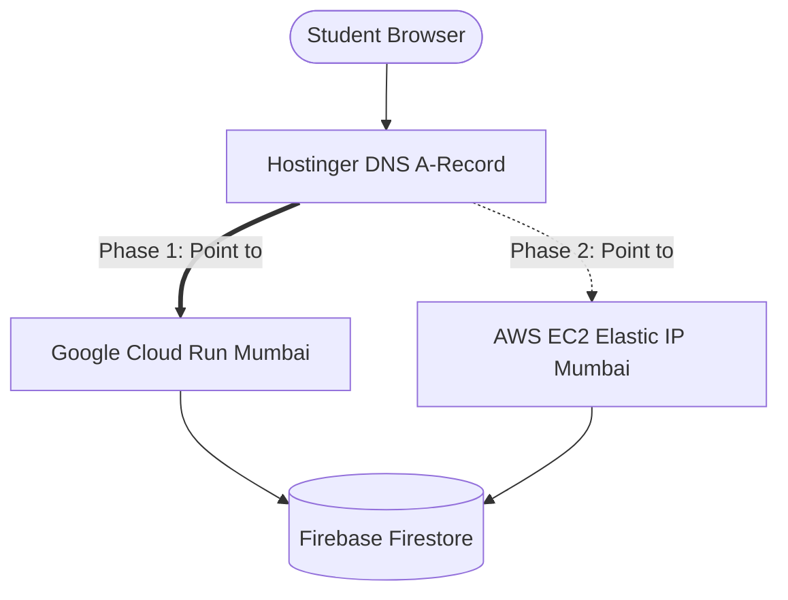

# MITAOE-Prep: Complete Cloud Architecture, Sizing, CI/CD & Multi-Cloud Guide

This document captures the end-to-end infrastructure strategy, technical designs, sizing calculations, pricing models, CI/CD pipelines, and migration runbooks for scaling **MITAOE-Prep** to **1,000–2,000 registered candidates** (~**500 peak concurrent test-takers**).

---

## 1. Executive Master Plan: The "7+ Months for ₹0" Credit Roadmap

You currently have two pools of cloud credits:
1. **Google Cloud Platform (GCP)**: **₹25,000 INR** (valid for the next **70 days**).
2. **Amazon Web Services (AWS)**: **$100 USD** (~₹9,500 INR @ ₹95/USD, standard credits).

### The Multi-Cloud Sequencing Strategy

```
========================================================================================
PHASE 1: NEXT 70 DAYS (Day 1 -> Day 70)
Provider: Google Cloud Platform (GCP)
Primary Service: Google Cloud Run (Mumbai: asia-south1)
Database: Firebase Firestore (Blaze Plan linked to GCP Billing)
Cost: 100% COVERED by ₹25,000 GCP Credits (Out of pocket: ₹0)
========================================================================================
                                           |
                    [ Day 70: Repoint Hostinger DNS to AWS Elastic IP ]
                                           v
========================================================================================
PHASE 2: MONTHS 3 TO 8 (Day 71 -> ~Day 220)
Provider: Amazon Web Services (AWS)
Primary Service: EC2 (t4g.small 24/7 + c7g.xlarge on Exam Days in Mumbai: ap-south-1)
Database: Firebase Firestore
Cost: 100% COVERED by $100 AWS Credits (~5.2 Months Runway) (Out of pocket: ₹0)
========================================================================================
```

**Total Result**: **7 to 8 full months of production, high-capacity hosting for ₹0 out-of-pocket.**

---

## 2. Phase 1: Google Cloud Run Architecture (Current & Primary)

### Why Cloud Run is the Best Fit for Exam Workloads

* **Instant Elastic Auto-Scaling**:
  * Off-exam periods: `--min-instances 1`. Keeps 1 instance warm 24/7. Student logins, test result reviews, and leaderboards load instantly with zero cold starts.
  * 10:00 AM Exam Spike: When 500 candidates enter simultaneously, Cloud Run spins up 5–15 container replicas in seconds to absorb the load.
  * Post-Exam: Automatically scales back down. Zero wasted compute.
* **Self-Healing & Fault Tolerance**:
  * If an instance encounters a memory leak or crash, Cloud Run replaces it within 2 seconds. No single point of failure.
* **Zero Linux / OS Maintenance**:
  * No SSH key management, no Nginx reverse proxies, no PM2 process monitor crashes.
* **Firebase Co-Location**:
  * Cloud Run in `asia-south1` (Mumbai) communicates with Firebase Firestore over Google’s internal private network backbone for ultra-low latency.

### Hostinger Domain & Cloud Run Networking (No Elastic IP Required)

In AWS EC2, you must allocate and pay for an Elastic IP. **In Cloud Run, Google provides its Global Anycast Edge Network for FREE.**

#### How to Point your Hostinger Domain to Cloud Run:
1. In Google Cloud Console &rarr; Cloud Run &rarr; Click **"Manage Custom Domains"** &rarr; **"Add Mapping"**.
2. Enter your domain (e.g., `mitaoeprep.com` or `exam.mitaoeprep.com`).
3. Google provides the exact DNS records to enter into Hostinger:

| Record Type | Host / Name | Target / Value | Purpose |
| :--- | :--- | :--- | :--- |
| **CNAME** (for subdomain e.g. `prep`) | `prep` | `ghs.googlehosted.com` | Standard subdomain routing |
| **A** (for root domain `@`) | `@` | `216.239.32.21`<br>`216.239.34.21`<br>`216.239.36.21`<br>`216.239.38.21` | Google Anycast Global IPs |

4. **Automatic SSL**: Google automatically generates and renews a free SSL certificate (HTTPS) for your Hostinger domain. Zero manual Certbot setup.

---

## 3. Automated CI/CD Pipeline for Cloud Run

### Option A: Built-in Continuous Deployment (Easiest — 2-Minute Setup)
Google Cloud Run has a direct, native integration with GitHub:
1. In Cloud Run console, click **"Continuously deploy from a repository"**.
2. Select your repository: `atharvabaodhankar/MITAOE-Prep`.
3. Choose branch: `main`.
4. Select Build Type: **Dockerfile**.
5. Save.

**Day-to-day workflow**:
Every time you run `git push origin main`, Google Cloud Build automatically builds the Docker image and deploys the new revision to Cloud Run.

### Option B: GitHub Actions Workflow (`.github/workflows/deploy.yml`)
For complete control over testing, environment variables, and deployment triggers:

```yaml
name: Deploy Next.js to Google Cloud Run

on:
  push:
    branches: [ main ]

jobs:
  deploy:
    name: Build & Deploy
    runs-on: ubuntu-latest
    steps:
      - name: Checkout Code
        uses: actions/checkout@v4

      - name: Authenticate to Google Cloud
        uses: google-github-actions/auth@v2
        with:
          credentials_json: ${{ secrets.GCP_SA_KEY }}

      - name: Set up Cloud SDK
        uses: google-github-actions/setup-gcloud@v2

      - name: Deploy to Cloud Run
        run: |
          gcloud run deploy mitaoe-prep \
            --source . \
            --region asia-south1 \
            --platform managed \
            --allow-unauthenticated \
            --min-instances 1 \
            --max-instances 20 \
            --memory 2Gi \
            --cpu 2
```

### Zero-Downtime Rolling Revisions
When deploying updates while students are online:
* Cloud Run deploys the new code as a background revision.
* It sends health check probes.
* It redirects user traffic only **after** the new revision is 100% healthy.
* If a new build fails, it leaves the old version running without dropping a single student request.

---

## 4. Phase 2: AWS EC2 Architecture (Fallback / Post-Day 70)

When your 70-day GCP credits expire, you seamlessly switch your Hostinger DNS to AWS EC2 using your $100 credit.

### The "Dynamic-Resize" EC2 Strategy

Do not turn off EC2 completely on non-exam days (otherwise students cannot log in or check leaderboards). Instead, resize between two Graviton3 (ARM) tiers:

```
+--------------------------------------------------------------------------+
| NORMAL DAYS (24/7):  t4g.small  (2 vCPU, 2 GB RAM)                      |
| -> Serves logins, leaderboards, admin dash, results review with 0 lag.    |
+--------------------------------------------------------------------------+
                                    |
                  [ EXAM DAY: 60-Second Stop & Resize ]
                                    v
+--------------------------------------------------------------------------+
| EXAM WINDOW (3-4 Hrs): c7g.xlarge (4 vCPU, 8 GB RAM, Graviton3)          |
| -> 500 concurrent candidate proctoring, exam timers, answer validation.   |
+--------------------------------------------------------------------------+
                                    |
                  [ POST-EXAM: 60-Second Resize Back ]
                                    v
+--------------------------------------------------------------------------+
| NORMAL DAYS (24/7):  t4g.small  (2 vCPU, 2 GB RAM)                      |
+--------------------------------------------------------------------------+
```

### Itemized AWS Monthly Cost Breakdown (ap-south-1 Mumbai @ ₹95 / 1 USD)

| Component | Specification | Pricing Rate | Monthly Cost (USD) | Monthly Cost (INR @ ₹95) |
| :--- | :--- | :--- | :--- | :--- |
| **Baseline EC2** | `t4g.small` (2 vCPU, 2 GB RAM, ARM) | $0.0168 / hr × 720 hrs | **$12.10** | **₹1,150** |
| **Elastic IP** | 1 Static IPv4 assigned to instance | $0.005 / hr × 730 hrs | **$3.65** | **₹347** |
| **Storage (EBS)** | 30 GB gp3 SSD (OS + Node build + logs) | $0.08 / GB-month | **$2.40** | **₹228** |
| **Exam Upscaling** | `c7g.xlarge` (4 vCPU, 8 GB RAM) | $0.145 / hr × ~6 hrs/mo | **$0.87** | **₹83** |
| **TOTAL** | — | — | **~$19.02 / mo** | **~₹1,808 / mo** |

$$\text{AWS Credit Runway} = \frac{\$100 \text{ Credits}}{\$19.02 \text{ / month}} \approx \mathbf{5.2 \text{ Months}}$$

---

## 5. Hostinger DNS Repointing: Moving Between GCP and AWS in 5 Minutes

Because **Firebase Firestore** holds all database state, your compute layer is **completely stateless**.



### When switching from GCP to AWS (or between AWS Accounts):
1. **On AWS**: Launch instance, allocate Elastic IP (e.g. `13.235.45.67`), start Next.js via PM2/Docker.
2. **On Hostinger**: Open DNS Zone &rarr; Edit `A Record` &rarr; Replace GCP IP with AWS Elastic IP.
3. **Propagation**: With Hostinger TTL set to **300 seconds (5 min)**, traffic migrates smoothly within minutes with zero data loss.
4. **Cleanup Old Accounts**: Always release unused Elastic IPs to prevent idle billing ($0.005/hr).

---

## 6. Zero Vendor Lock-in: Docker Portability

To ensure our application can move between Cloud Run, AWS EC2, AWS ECS, or any VPS seamlessly, we use the standard multi-stage production Dockerfile.

### Production `Dockerfile` for Next.js

```dockerfile
# 1. Dependencies stage
FROM node:20-alpine AS deps
WORKDIR /app
COPY package.json package-lock.json ./
RUN npm ci

# 2. Builder stage
FROM node:20-alpine AS builder
WORKDIR /app
COPY --from=deps /app/node_modules ./node_modules
COPY . .
ENV NEXT_TELEMETRY_DISABLED=1
RUN npm run build

# 3. Production runner stage
FROM node:20-alpine AS runner
WORKDIR /app
ENV NODE_ENV=production
ENV NEXT_TELEMETRY_DISABLED=1
ENV PORT=3000
ENV HOSTNAME="0.0.0.0"

# Copy output standalone build
COPY --from=builder /app/public ./public
COPY --from=builder /app/.next/standalone ./
COPY --from=builder /app/.next/static ./.next/static

EXPOSE 3000
CMD ["node", "server.js"]
```

> [!NOTE]
> To enable the ultra-lean `standalone` output, ensure `next.config.ts` has:
> ```ts
> const nextConfig = {
>   output: 'standalone',
> };
> export default nextConfig;
> ```

---

## 7. Firebase Firestore Quota Safeguards

Regardless of hosting on GCP Cloud Run or AWS EC2:
* **Heartbeat Throttling**: In `app/api/proctor/heartbeat/route.ts`, throttle phone heartbeat writes to Firestore to once every **15–20 seconds** (instead of every 1.5 seconds) using an in-memory timestamp comparison.
* **Impact**: Eliminates **85% to 90%** of Firestore billable writes during high-volume 500-candidate exams, keeping database usage well within free or credit-covered limits.
